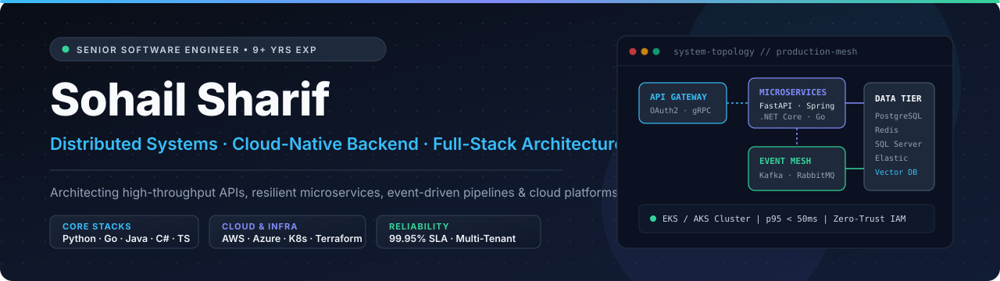

  

  
  &nbsp;
  
  &nbsp;
  
  &nbsp;
  

---

## ⚡ Executive Summary

I am a **Senior Software Engineer** with **9+ years of experience** designing, building, and scaling enterprise backend architectures, distributed microservices, cloud-native platforms, and full-stack web applications.

- 🏗️ **System Architecture & Backend Engineering:** High-concurrency APIs, multi-tenant SaaS backends, double-entry financial ledgers, and distributed workflow engines across **Python, Go, Java, C# / .NET, and TypeScript**.
- ☁️ **Cloud & Platform Reliability:** Production infrastructure automation, Kubernetes (EKS/AKS) orchestration, Terraform IaC, CI/CD release gates, and full-stack observability (**Prometheus, Grafana, Datadog, CloudWatch**).
- 🔄 **Event-Driven & Intelligent Integrations:** Asynchronous messaging pipelines (**Kafka, RabbitMQ, Celery, Redis**) and production **LLM / RAG** workflows with strict tenant isolation and low-latency guarantees.

---

## 🛠️ Technology Stack & Engineering Ecosystem

### **Core Languages**

  
  
  
  
  
  
  

### **Backend Frameworks & API Protocols**

  
  
  
  
  
  
  
  

### **Frontend & Web Interfaces**

  
  
  
  
  
  

### **Databases, Caching & Event Streaming**

  
  
  
  
  
  
  
  

### **Cloud, DevOps, Observability & AI**

  
  
  
  
  
  
  
  
  

---

## 🏛️ Featured Engineering Systems & Architecture Repositories

| System Repository | Stack & Domain | Architectural Focus & Engineering Highlights |
| :--- | :--- | :--- |
| **[clean-architecture-tenant-api](https://github.com/sohail-sharif-official/clean-architecture-tenant-api)** | `C#` · `.NET` · `EF Core` · `PostgreSQL` | Strict multi-tenant isolation, domain invariants, defensive tenant guardrails, and clean layer boundaries. |
| **[transactional-payment-ledger](https://github.com/sohail-sharif-official/transactional-payment-ledger)** | `Java 21` · `Spring Boot` · `PostgreSQL` | Double-entry financial ledger with zero-sum invariant checks, idempotency keys, and transactional outbox pattern. |
| **[saga-order-orchestrator](https://github.com/sohail-sharif-official/saga-order-orchestrator)** | `C#` · `.NET` · `Distributed Sagas` | Deterministic saga state machine with reverse-order compensating transactions and explicit failure recovery. |
| **[distributed-job-scheduler](https://github.com/sohail-sharif-official/distributed-job-scheduler)** | `Java 21` · `Spring Boot` · `Quartz` | Lease-based exclusive job claiming, heartbeat expiry, bounded retries, and dead-letter queue isolation. |
| **[event-driven-notification-service](https://github.com/sohail-sharif-official/event-driven-notification-service)** | `Java 21` · `Kafka` · `Spring Boot` | Multi-tenant rate windows, idempotent event deduplication, retry topics, and multi-channel fan-out routing. |
| **[workflow-automation-builder](https://github.com/sohail-sharif-official/workflow-automation-builder)** | `TypeScript` · `Node.js` · `React` | Directed acyclic graph (DAG) cycle detection, ordered step execution engine, and bounded retry policies. |
| **[lead-management-crm](https://github.com/sohail-sharif-official/lead-management-crm)** | `TypeScript` · `React` · `Node.js` | Tenant-scoped lead indexing, deterministic territory routing rules, RBAC permissions, and audit timelines. |
| **[email-campaign-platform](https://github.com/sohail-sharif-official/email-campaign-platform)** | `TypeScript` · `Node.js` · `PostgreSQL` | Multi-tenant campaign dispatch core with throttled sending, bounce webhook ingestion, and unsubscribe enforcement. |

---

## 🎯 Core Engineering Principles

| 1. Resilient System Design | 2. Security & Multi-Tenancy | 3. Operational Excellence |
| :--- | :--- | :--- |
| Design for partial failure using idempotency keys, circuit breakers, bounded retries, and transactional outbox patterns. | Enforce defense-in-depth with OAuth 2.0 / JWT, RBAC, tenant-scoped data isolation, and automated container scanning. | Pair every service with structured telemetry, SLO latency tracking, automated CI verification, and reproducible IaC. |

---

  <strong>Sohail Sharif — Senior Software Engineer</strong> 
  Pennsylvania, United States · <a href="mailto:sohailsharif.official@gmail.com">sohailsharif.official@gmail.com</a> · <a href="https://www.linkedin.com/in/sohail-sharif-4a0735248/">LinkedIn</a>

