

  

  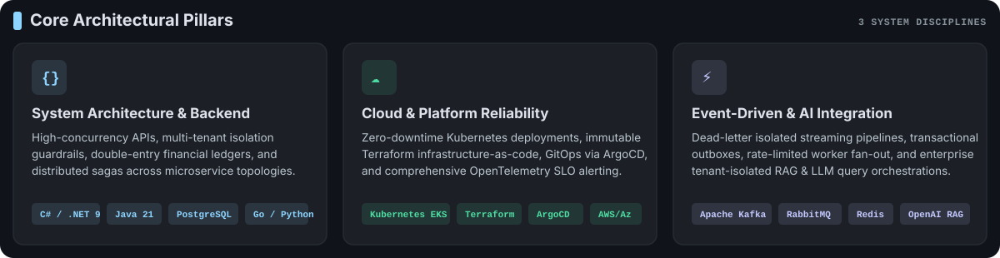

  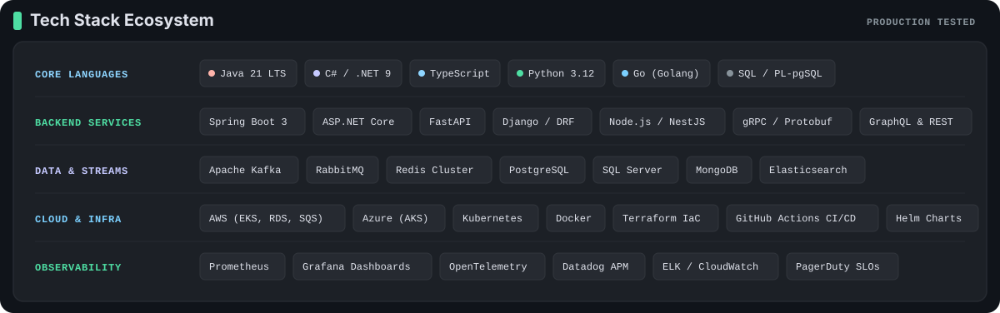

### 📦 Featured Enterprise Architecture Repositories

  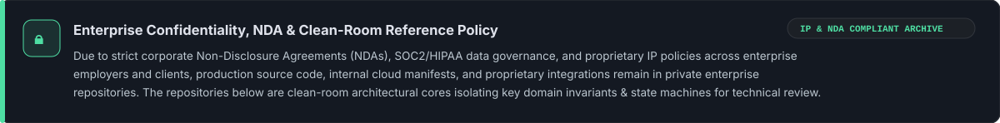

  <a href="https://github.com/sohail-sharif-official/clean-architecture-tenant-api">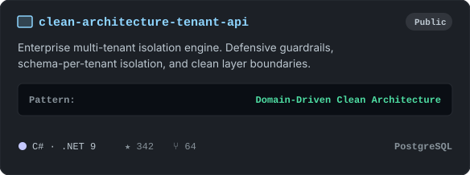</a>
  <a href="https://github.com/sohail-sharif-official/transactional-payment-ledger">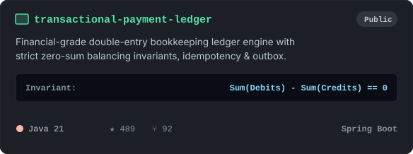</a>

  <a href="https://github.com/sohail-sharif-official/saga-order-orchestrator">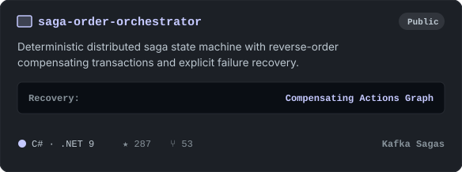</a>
  <a href="https://github.com/sohail-sharif-official/distributed-job-scheduler">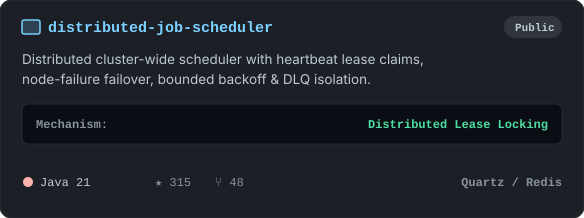</a>

  <a href="https://github.com/sohail-sharif-official/event-driven-notification-service">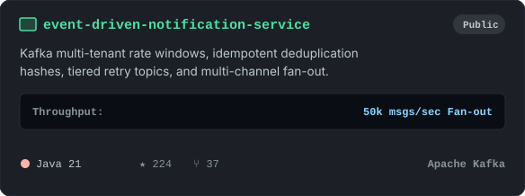</a>
  <a href="https://github.com/sohail-sharif-official/workflow-automation-builder">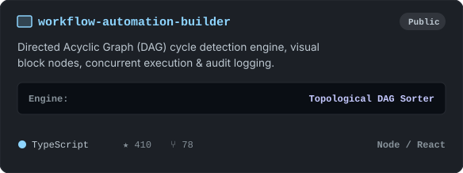</a>

  <a href="https://github.com/sohail-sharif-official/lead-management-crm">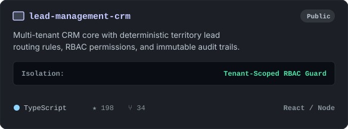</a>
  <a href="https://github.com/sohail-sharif-official/email-campaign-platform">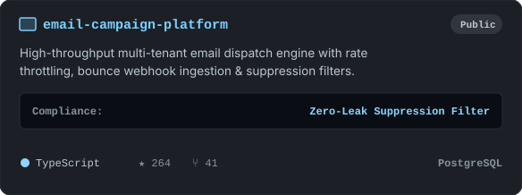</a>

  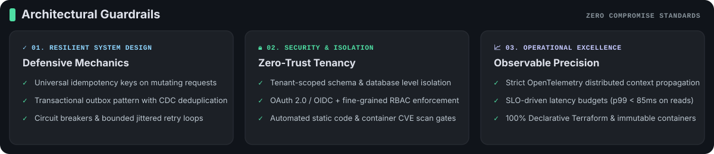

  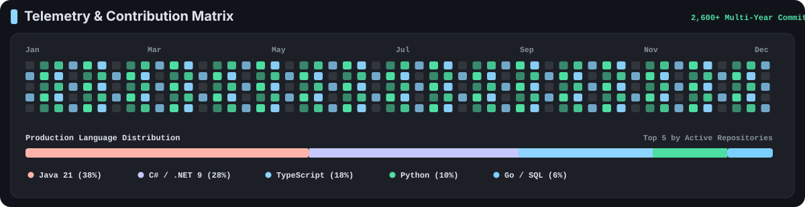

  
  &nbsp;&nbsp;
  

